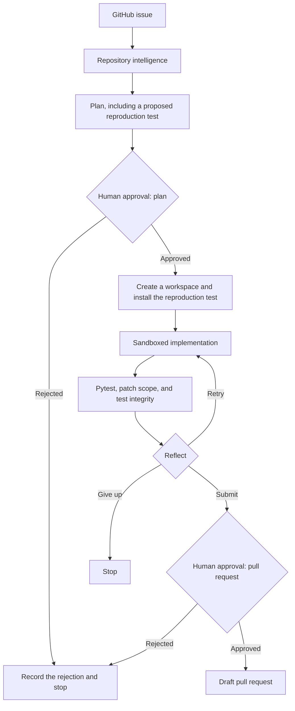

# Issue-to-Draft-PR Agent

[](https://github.com/MadanMohan0537/issue-to-draft-pr-agent/actions/workflows/ci.yml)
[](LICENSE)

**A coding agent that turns a GitHub issue into a tested draft pull request. It proposes a reproduction test before editing, checks commands and patches against policy, and stops for a person twice: before implementation, and again before opening the pull request.**

Previously named *autonomous-software-engineer-platform*. The import package and the `ase` CLI keep that name. The installable distribution name in `pyproject.toml` is still `autonomous-software-engineer` (package version 0.2.0). `ase.__version__` is still `0.1.0`.

The CI badge tracks [`.github/workflows/ci.yml`](.github/workflows/ci.yml) on `main`. That workflow is currently failing. Details are under [Limitations](#limitations).

## Problem and who it's for

Coding agents can produce plausible patches. An engineering team still needs harder answers. Did the agent reproduce the problem before editing? Is the patch limited to the requested scope? Did it add meaningful tests or weaken existing ones? Can a reviewer reconstruct the commands and decisions? This repository is aimed at engineering managers and tech leads who are evaluating AI coding tools, and at the AI and IT PMs who own the governance around those tools.

## Approach

Planning, execution, verification, and review are separate stages. The issue-to-PR path in `src/ase/agent/graph.py` is:



The two human gates are `await_plan_approval` and `await_pr_approval`. Both default to required. `.ase/policy.yaml` sets `open_draft_pull_request: human_approval`, which keeps the pull-request gate on, and it does not turn the plan gate off.

With `ase run --graph` (the `graph` extra), LangGraph interrupts at each gate and stores a SQLite checkpoint, so another process can resume the run. Without `--graph`, the same nodes run in sequence and ask for each decision in the terminal. `--auto-approve` records both approvals without asking. That flag is for evaluation runs.

A rejection is written to the trace store and the run stops. It does not automatically revise the patch or write a feedback-ledger row. Revision happens earlier: if verification fails, the reflect step can send the run back to implementation before the pull-request gate.

The reproduction test is part of the plan. It is written only after the plan is approved, and only kept when it fails on the base commit. Editing starts after that. If no failing test is known, the run records that the whole suite is the acceptance check.

Other boundaries in code and `.ase/policy.yaml`:

- There is no merge implementation. `CanaryController.deploy` checks `deploy_production` and raises `AuthorityDenied` under the default policy. If that check were ever allowed, the method still raises `NotImplementedError`.
- Agent commands are argv arrays. The policy engine allowlists executables and rejects shell interpreters. `git merge` and `git push` are denied subcommands.
- The Docker sandbox starts containers with `--network none` unless `execution.network` is `allowed`. The default `local` backend does not enforce a network boundary.
- Verification rejects a patch that adds `pytest` skip or focus markers, edits test files when the task is not about tests, or changes or removes the installed reproduction test. Missing policy keys keep the defaults, which deny merge, deploy, and sandbox network, and require both approvals. An unknown authority action is denied.

Mutation testing is a separate command. It is not a stage between implementation and the pull-request gate.

## What exists today

Checked against the code in this repository, package version 0.2.0. The offline commands in [Quick start](#quick-start) were run while writing this file.

| Module | Implemented |
|---|---|
| 1. Repository intelligence | Python parsing with tree-sitter and a standard-library `ast` fallback. Python files are chunked by definition. TypeScript, JavaScript, Go, Rust, and Java get regex line-level symbols and window chunks, with no call graph. Search uses BM25, hashing or Voyage embeddings, and reciprocal-rank fusion. A NetworkX code graph builds a personalized-PageRank repo map. `ase knowledge eval` measures recall@k against git history. |
| 2. Issue-to-PR agent | A reproduction test installed after plan approval and before edits, constrained edit and argv command tools, pytest plus patch-scope and test-integrity checks, the two human gates above, resumable LangGraph runs with a SQLite checkpoint, and draft pull requests through the GitHub Git Data API when `GITHUB_TOKEN` is set. Without a token, delivery writes the patch locally. |
| 3. Testing | `ase mutate` runs mutation testing on chosen files. `ase gen-tests` calls the model and keeps a generated test only when it kills a mutant. |
| 4. CI/CD | Actions triage for the agent's draft pull requests (rules first, model second, unknown failures escalated). `ase canary simulate` is a decision engine over SLO windows. It does not deploy. |
| 5. Evaluation | Tasks harvested from git history, grading by applying the patch to a clean checkout, report tables, and a SWE-bench adapter that writes a predictions file for the official harness. `evals/results/` contains no committed results. |
| 6. Human feedback | Pull-request review sync into the trace store, a labeled dataset, a heuristic scorer, and a logistic scorer. Logistic training refuses fewer than 30 examples, or a dataset whose labels are all the same. The LoRA helper refuses fewer than 200 reviewed labels, and also refuses a one-sided label split. Its `train` function raises `NotImplementedError`. |

Also in the tree: a FastAPI app (`src/ase/api.py`) that serves a console at `/` and API docs at `/docs`, with `POST /api/runs/{id}/plan-review`, `POST /api/runs/{id}/pr-review`, and `GET /api/runs/{id}/trace`. Those routes use the orchestrator in `src/ase/orchestrator.py`, which stops at the approval states. They do not start the LangGraph agent. Docker Compose, `docker/sandbox.Dockerfile`, and the Kubernetes manifests in `deploy/k8s/` are present. The manifests still reference `ghcr.io/madanmohan0537/autonomous-software-engineer-platform:latest`. Model calls from the agent use the Anthropic Messages API. Offline tests use a scripted client. Persistence in this tree is SQLite.

Not in this tree: a merge implementation, a deployment backend, a trained LoRA reward model, a SWE-bench score, call graphs for languages other than Python, PostgreSQL, pgvector, Redis, or microVM backends, a GitHub App install flow (a personal or fine-grained token is used), live-model tests in CI, and a Cloudflare Worker. See [Deployment](#deployment).

## How success would be measured

No measured results are committed in this repository. `evals/results/` is empty apart from a placeholder.

| Dimension | Metric | Status |
|---|---|---|
| Correctness | Issue resolution rate on hidden tests | Not yet measured |
| Testing | Mutation-score change from generated tests | Tooling exists (`ase mutate`, `ase gen-tests`). Not yet measured |
| Scope | Unnecessary-file change rate | Not yet measured |
| Human value | Plan approval and pull-request acceptance rates | Not yet measured |
| Efficiency | Time, tokens, and cost per accepted patch | Each run can store token counts, cost, and step duration. Not yet measured |
| Retrieval | recall@k against the repository's own history | `ase knowledge eval` runs offline. Not yet measured |

A green pytest report is one check. The pull-request gate also requires the patch-scope and test-integrity checks, and a person still has to approve the draft.

## Limitations

- Only Python gets definition spans, imports, and a call graph. Other supported languages get line-level regex symbols.
- The agent needs `ANTHROPIC_API_KEY` for live model calls. Opening a GitHub draft pull request, CI triage, and review sync need `GITHUB_TOKEN`. CI exercises the model with scripted completions.
- The default `local` sandbox is for development. It checks argv and paths and does not isolate the network. Use `ASE_EXECUTION_BACKEND=docker` with the sandbox image for the container boundary.
- NetworkX 3.7's `pagerank` imports SciPy. SciPy is not in the install extras. With the extras in the quick start, `python -m pytest` collected 135 tests and failed 11, all with `ModuleNotFoundError: No module named 'scipy'`, in the agent-flow, CLI, eval-runner, graph, and knowledge tests. The `pytest` console script that `make check` uses does not get that far today: `make check` stops at mypy. Invoking that console script directly also stops during collection of `tests/test_cli.py`, `tests/test_evals.py`, `tests/test_graph.py`, and `tests/test_knowledge.py`, which import the `tests` package. `tests/` has no `__init__.py`.
- No benchmark results are committed.
- `ase.__version__` does not match the package version.

### Known CI failure

This is not fixed in the README change. The `CI` workflow on `main` failed on 2026-09-16 and 2026-10-04. The last successful run was on 2026-09-15. On the failing runs, `ruff check` and `ruff format --check` passed, then `mypy src` failed, so the pytest and CLI smoke steps did not run.

The runner uses Python 3.12 and `pip install -e '.[dev,index,graph,sandbox]'`. The 2026-10-04 log installed numpy 2.5.3 and reported:

```text
numpy/__init__.pyi:737: error: Type statement is only supported in Python 3.12 and greater  [syntax]
```

`[tool.mypy] python_version = "3.11"` is applied to those numpy 2.5 stubs, which use the Python 3.12 `type` statement. The same `mypy src` error reproduced locally on Python 3.12.3 with numpy 2.5.4. `make check` exits at that step.

## Quick start

Requires Python 3.11+ and git. The first block needs no model key and no GitHub token. These commands completed against this tree: install, `ase index`, `ase knowledge build`, `ase knowledge search`, `ase canary simulate`, and `ase knowledge eval`.

```bash
git clone https://github.com/MadanMohan0537/issue-to-draft-pr-agent.git
cd issue-to-draft-pr-agent
python -m venv .venv && source .venv/bin/activate
pip install -e '.[dev,index,graph,sandbox]'

ase index . --output artifacts/index.json
ase knowledge build .
ase knowledge search . "how are pull request reviews mirrored" -k 5
printf '[{"requests":100,"errors":1,"p95_ms":120},{"requests":100,"errors":0,"p95_ms":110}]' > windows.json
ase canary simulate windows.json
```

`ase knowledge eval . --limit 20` prints recall@k for this clone. That number is not a committed result.

`make check` runs Ruff, `mypy src`, and pytest with an 85% coverage gate. It currently stops at `mypy src`. See [Known CI failure](#known-ci-failure).

Run the agent on an issue (needs a model key). `--graph` pauses at the plan gate, then again at the pull-request gate:

```bash
export ANTHROPIC_API_KEY=...
ase run . --graph --issue 1 --title "harvest fails on a root commit" \
  --body "ase eval harvest raises CalledProcessError when the repo has a single commit"
ase resume . <run_id> --approve      # plan gate: workspace, reproduction, implement, verify
ase resume . <run_id> --approve      # pull-request gate
```

A real GitHub draft pull request needs `GITHUB_TOKEN` and `--remote owner/name` on the original `ase run`. `ase resume` only records the decision. Without a token, delivery writes the patch under the data directory and the run can still finish as submitted.

API and console:

```bash
ASE_REPOSITORY_ROOT=$PWD uvicorn ase.api:app --reload
```

The console is at http://127.0.0.1:8000 and the API docs are at `/docs`. `.env.example` lists the settings the process reads.

Design notes: [docs/DESIGN.md](docs/DESIGN.md), [ADRs](docs/adr/README.md), [threat model](docs/THREAT_MODEL.md), [evaluation plan](docs/EVALUATION.md).

## Deployment

Cloudflare Workers is the planned deployment target. This repository has no `wrangler.toml`, no Worker entry point, and no Workers bindings. It is not deployed to Cloudflare Workers, and there is no Worker name or `workers.dev` hostname to preserve.

What would have to land before a deploy:

- a `wrangler.toml`
- a Worker entry point
- for this Python codebase, either Python Workers or a JavaScript/TypeScript port of the piece that should run on Workers

After that configuration exists, deploy with:

```bash
npx wrangler deploy
```

`docker-compose.yml`, `docker/sandbox.Dockerfile`, and `deploy/k8s/` are in the repository. They are local and Kubernetes manifests, separate from the Workers target. The canary command above only simulates a promote or roll-back decision.

## License

[Apache License 2.0](LICENSE)
